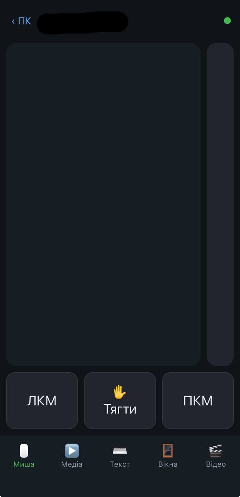

# PC Remote

🇺🇦 [Українська версія](README.md)

A free alternative to Remote Mouse: control a Windows PC from your phone (iOS and Android) through the browser.
No native phone app is needed, the PC server hosts the interface itself.

<!-- Screenshots: put the files into docs/ and uncomment the line below
<p align="center">  </p>
-->

## Features

- Touchpad: move, click, right click, scroll, drag and drop (tap-and-drag, or the "Drag" lock button)
- Media: play/pause, next/previous, volume, mute
- Video (YouTube): 10 s seek, fullscreen, subtitles, speed, next/previous video
- Text input from the phone (including non-Latin layouts)
- List of running windows with real app icons, switch and close
- Multiple PCs: the first screen lists your computers with online status
- Connects by PC name (`NAME.local`), no IP addresses to remember
- Connection drops when the phone is locked (saves battery)
- Tray icon, autostart on Windows logon

## Installation

Requires Windows 10/11 and Python 3.10+ (tick "Add python.exe to PATH").
Python is not needed if you use the prebuilt `PCRemote.exe` from [Releases](../../releases).

1. Download the ZIP (Code → Download ZIP) or clone into a stable folder, for example `C:\PCRemote`:
   ```
   git clone https://github.com/187qZen/open-remote-mouse-ua.git C:\PCRemote
   ```
   Do not keep it in `Downloads`: the autostart task is bound to the folder path.
2. *(Optional)* Run `build.bat` to build `PCRemote.exe` yourself.
3. Run `install_autostart.bat` **as administrator**.
   It creates the autostart task, opens port 8765 for private networks and starts the server.
4. Click the PC Remote tray icon near the clock to see the address and PIN.
5. On your phone (same Wi-Fi) open `http://PC-NAME.local:8765`, enter the PIN
   and add the page to the home screen (Safari: Share → Add to Home Screen).

To add another PC, install the server on it too, then tap "＋ Add" in the app.

To remove autostart: `uninstall_autostart.bat` (as administrator).

## Windows Defender and the exe

`PCRemote.exe` is built with PyInstaller, and antivirus software sometimes flags such files by mistake.
The source is fully open, so you can read it or build the exe yourself with `build.bat`.
If Defender blocks the file, add the program folder to exclusions or run `server.py` instead.

## Security

- Access is protected by a PIN (`config.json`, created on first run, never committed to the repo).
- After 30 failed PIN attempts within 10 minutes the address is temporarily blocked.
- Traffic is not encrypted (HTTP): use it only on a trusted home network.
- Never expose port 8765 to the internet.

## Limitations

- Windows only.
- Windows of programs running as administrator cannot be switched or typed into by a normal process.
- The `.local` address may not work on some Android devices, use the IP address instead (shown by the tray icon).
- The phone app loads from the PC itself, so if that PC is off, the home-screen icon will not open.

## License

MIT
